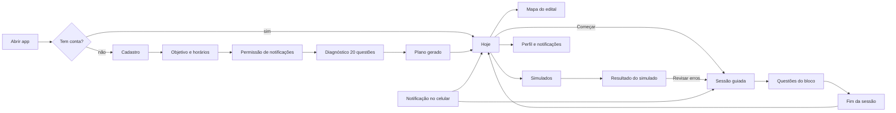

# APP_FLOW — Jornada do usuário (piloto)

> Versão 0.1 · 18/11/2026 · Conceito #18. Cada tela lista seus 6 estados (ver `DESIGN_SYSTEM.md`). Estados ainda não definidos aparecem como **GAP**.

## 1. Mapa geral

## 2. Telas

### T1. Cadastro
- **Entrada:** primeira abertura.
- **Ações:** e-mail + senha ou login com Google; aceite de termos e política de privacidade.
- **Respostas:** conta criada → T2.
- Estados: Loading (botão com spinner) · Empty (n/a) · Error ("Não foi possível criar a conta. Tentar de novo") · Success (vai para T2) · Validation (e-mail inválido, senha < 8, termos não aceitos) · Disabled (botão desabilitado até aceitar termos).

### T2. Objetivo e horários
- **Ações:** escolher concurso (só "Banestes — Técnico Bancário" no piloto), polo, horas por dia da semana, horários de estudo, limite de horas extras por dia (compensação).
- **Respostas:** salva matrícula → T3.
- Estados: Loading · Empty (n/a) · Error · Success · Validation (nenhum dia com horas; horas que não cabem até a prova → aviso) · Disabled (Continuar até preencher).

### T3. Permissão de notificações
- **Ações:** explicação do uso dos avisos → "Permitir" ou "Agora não".
- **Respostas:** registra token do dispositivo → T4. "Agora não" segue, com lembrete na tela Hoje.
- Estados: Loading · Empty (n/a) · Error (falha ao registrar token: segue e tenta de novo depois) · Success · Validation (n/a) · Disabled (n/a).

### T4. Diagnóstico
- **Ações:** 20 questões curtas (cerca de 2 por disciplina), pode pular.
- **Respostas:** nível por disciplina → gera plano → T5.
- Estados: Loading (carregando questão) · Empty (n/a) · Error (sem conexão: guarda respostas e retoma) · Success · Validation (n/a) · Disabled (Próxima até escolher ou pular).

### T5. Plano gerado
- **Mostra:** resumo do plano (horas totais até 24/01, disciplinas priorizadas, primeira sessão).
- **Ações:** "Ir para Hoje", "Ajustar horários".
- Estados: Loading ("Montando seu plano…") · Empty (n/a) · Error (plano não gerado → tentar de novo) · Success · Validation (horas insuficientes → mostra o que será cortado e pede confirmação) · Disabled (n/a).

### T6. Hoje (tela inicial)
- **Mostra:** cartão "Próximo passo" (tópico, minutos, tipo), revisão do dia, semana, dias para a prova, dívida de horas, alertas.
- **Ações:** Começar (→ T7), ver mapa (→ T9), simulados (→ T10), perfil (→ T12).
- Estados: Loading (skeleton) · Empty (dia livre: "Hoje é dia de descanso. Quer adiantar algo?") · Error (sem conexão: mostra o último plano salvo com aviso) · Success (após sessão: "+40 min, faltam 20 min hoje") · Validation (n/a) · Disabled (Começar desabilitado com motivo se o plano estiver sendo recalculado).

### T7. Sessão guiada
- **Ações:** ler/ouvir explicação, responder perguntas de checagem, pedir "explica de outro jeito", perguntar por texto ou voz, pausar.
- **Respostas:** IA avança quando o aluno acerta a checagem; ao fim → T8.
- Estados: Loading ("digitando…") · Empty (n/a) · Error (IA indisponível: "Tente em instantes" + oferece ir para questões do tópico) · Success (etapa concluída) · Validation (pergunta vazia) · Disabled (enviar desabilitado enquanto a IA responde).

### T8. Questões do bloco e fim da sessão
- **Ações:** responder questões, ver comentário por alternativa, reportar questão.
- **Respostas:** registra acertos/erros, atualiza domínio e plano; resumo da sessão → T6.
- Estados: Loading · Empty (sem questões publicadas do tópico: **GAP** — definir comportamento) · Error · Success · Validation (confirmar antes de enviar) · Disabled (alternativas bloqueadas após responder).

### T9. Mapa do edital
- **Mostra:** disciplinas → tópicos, com domínio (fraco/médio/forte/não visto) e % coberto.
- **Ações:** abrir tópico → estudar agora (gera sessão avulsa).
- Estados: Loading · Empty (antes do diagnóstico: tudo "não visto") · Error · Success · Validation (n/a) · Disabled (n/a).

### T10. Simulados
- **Ações:** iniciar simulado completo (70 questões, 4 h) ou por disciplina; retomar simulado em andamento.
- Estados: Loading · Empty ("Nenhum simulado ainda") · Error · Success · Validation (confirmar entrega com questões em branco) · Disabled (iniciar desabilitado se houver um em andamento).

### T11. Resultado do simulado
- **Mostra:** acertos, nota Gerais, nota Específicos, nota final ponderada, nota mínima 6,00, desempenho por disciplina.
- **Ações:** "Revisar erros com a IA" (→ T7).
- Estados: Loading ("Calculando nota…") · Empty (n/a) · Error · Success · Validation (n/a) · Disabled (n/a).

### T12. Perfil e notificações
- **Ações:** editar horários, limite de compensação, horário de silêncio, tipos de aviso, "pausar por hoje", sair, excluir conta e dados.
- Estados: Loading · Empty (n/a) · Error · Success ("Preferências salvas") · Validation (horário de silêncio inválido) · Disabled (n/a).

## 3. Entradas por notificação

| Notificação | Abre |
| --- | --- |
| Hora de estudar | T7 do bloco agendado |
| Sessão perdida | T6 com o bloco destacado |
| Compensação | T6 mostrando como a semana mudou |
| Revisão | Cartões de revisão (P1) |
| Simulado | T10 |
| Contagem regressiva / resumo semanal | T6 |

## 4. Recuperação e saída

- Sem conexão: leitura do último estado salvo; ações ficam na fila e sincronizam ao voltar.
- Sessão interrompida: retoma do ponto onde parou em qualquer dispositivo.
- Saída: logout em T12; exclusão de conta apaga dados pessoais (ver `SECURITY.md`).
