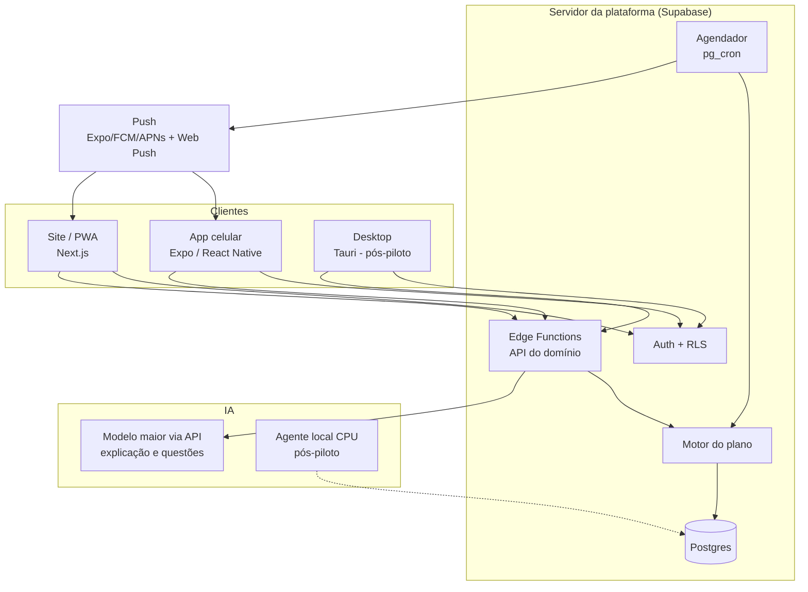
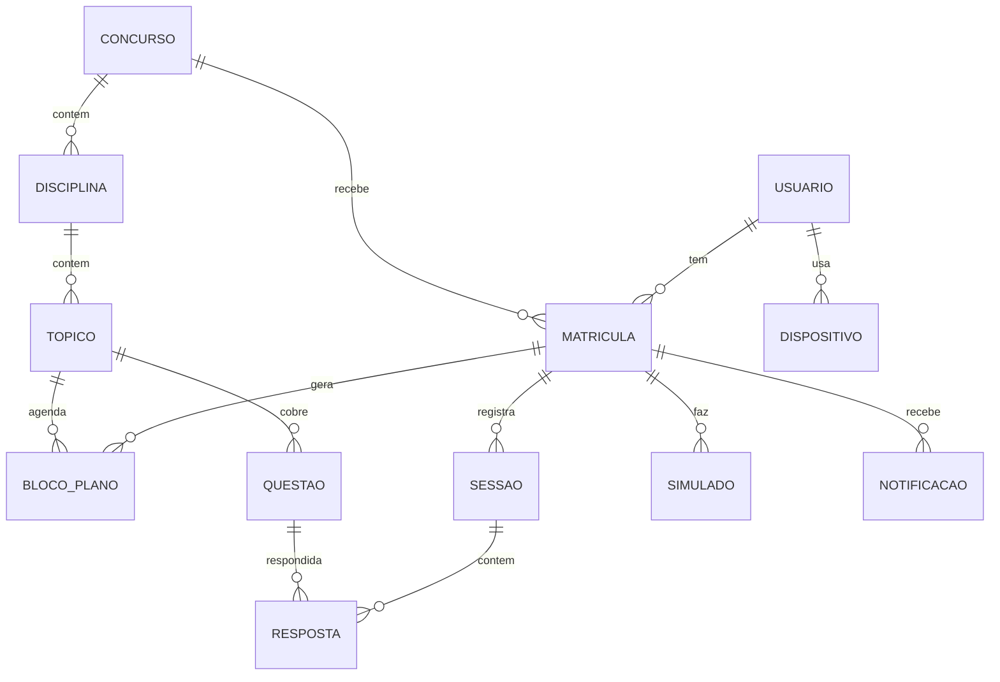
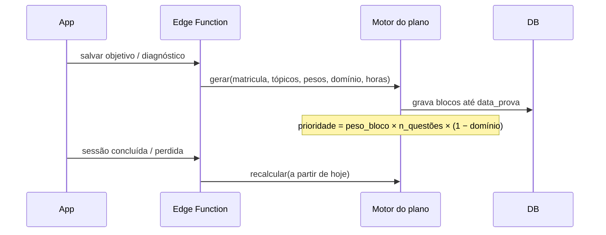
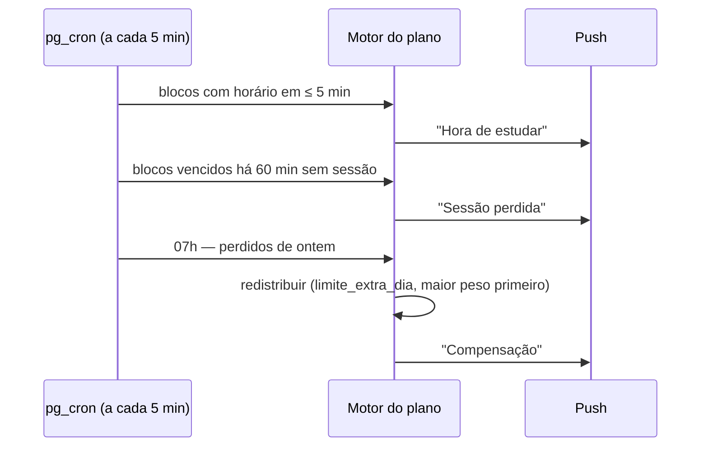

# ARCHITECTURE — Plataforma de estudos com IA

> Versão 0.1 · 18/11/2026 · Conceito #2. Decisões marcadas **[ADR-n]** estão justificadas em `DECISIONS.md`.
> Status: **proposta**, aguardando aprovação do dono antes da Fase 1.

## 1. Visão de alto nível

## 2. Tech stack

| Camada | Escolha | Motivo | ADR |
| --- | --- | --- | --- |
| App celular | Expo (React Native) + TypeScript | Um código para Android e iPhone; push nativo via Expo Notifications | ADR-1 |
| Site | Next.js (App Router) + TypeScript, PWA | Mesmo idioma do app; deploy simples na Vercel; web push | ADR-1 |
| Desktop (pós-piloto) | Tauri sobre o site | Leve; reaproveita o site | ADR-1 |
| Backend | Supabase: Postgres, Auth, RLS, Edge Functions, pg_cron, Storage | Multiusuário com regras no banco; cron nativo para avisos | ADR-2 |
| Deploy | Vercel (site), EAS (app), Supabase (backend) | Estágios preview/produção prontos | ADR-2 |
| IA de conteúdo | Modelo maior via API (provedor a escolher em `EVALUATION.md`) | Qualidade em português e explicações | ADR-3 |
| Agente local | Modelo de 3–4B via llama.cpp, em CPU, no servidor | Busca e organização baratas; pós-piloto | ADR-4 |
| Monorepo | pnpm + Turborepo | Tipos e regras compartilhados entre app e site | ADR-1 |

## 3. Estrutura de pastas

Ver `PROJECT_STRUCTURE.md`.

## 4. Modelo de dados (núcleo)

| Tabela | Campos-chave |
| --- | --- |
| `concurso` | id, nome, banca, data_prova, formula_nota (json), nota_minima |
| `disciplina` | id, concurso_id, nome, bloco (gerais/especificos), peso, n_questoes |
| `topico` | id, disciplina_id, nome, ordem, fonte (anexo IV) |
| `matricula` | id, usuario_id, concurso_id, polo, horas_semana (json), horarios, limite_extra_dia |
| `bloco_plano` | id, matricula_id, data, topico_id, tipo (teoria/questoes/revisao), minutos, status (previsto/feito/perdido/compensado) |
| `questao` | id, topico_id, enunciado, alternativas (json), gabarito, comentario, origem (gerada/real), status (rascunho/revisada/publicada/suspensa), revisor_id |
| `sessao` / `resposta` | progresso da sessão guiada e de cada questão |
| `simulado` | id, matricula_id, nota_gerais, nota_especificos, nota_final |
| `notificacao` | id, matricula_id, tipo, agendada_para, enviada_em, lida_em |
| `dispositivo` | id, usuario_id, plataforma, push_token |

## 5. Fluxos de dados críticos

**5.1 Geração e recálculo do plano** (motor do plano, função pura testável)

**5.2 Notificações e compensação**

**5.3 Sessão guiada:** app → Edge Function → monta contexto (tópico, nível, erros recentes, material aprovado) → modelo via API em streaming → resposta para o app; questões só saem do banco com status `publicada`.

## 6. Padrões de API

- REST via Edge Functions, JSON, versão no caminho (`/v1/...`).
- Paginação por cursor em listas (questões, histórico).
- Leituras simples direto do Supabase com RLS; regras de negócio sempre em Edge Function.
- Cache de explicações por (tópico, nível) e de questões geradas, para reduzir custo de API.
- Idempotência em "concluir sessão" e "responder questão" (chave por requisição).

## 7. Feature flags

Tabela `feature_flag` (chave, ativo, público). Flags previstas: `revisao_espacada`, `resumo_semanal`, `voz_na_sessao`, `agente_editais`. Toda flag nova é registrada aqui e em `DECISIONS.md`.

## 8. Estágios e deploy

LOCAL → PREVIEW (cada branch: Vercel preview + Supabase branch) → QA → PRODUÇÃO. Detalhe em `IMPLEMENTATION_PLAN.md` e `SECURITY.md` (variáveis separadas por estágio).

## 9. Escalabilidade

Piloto: ~30–100 alunos; plano gratuito/básico do Supabase e da Vercel atende. Gargalos esperados: custo de API do modelo (mitigar com cache) e cron de notificações (indexar `bloco_plano(data, status)`).
